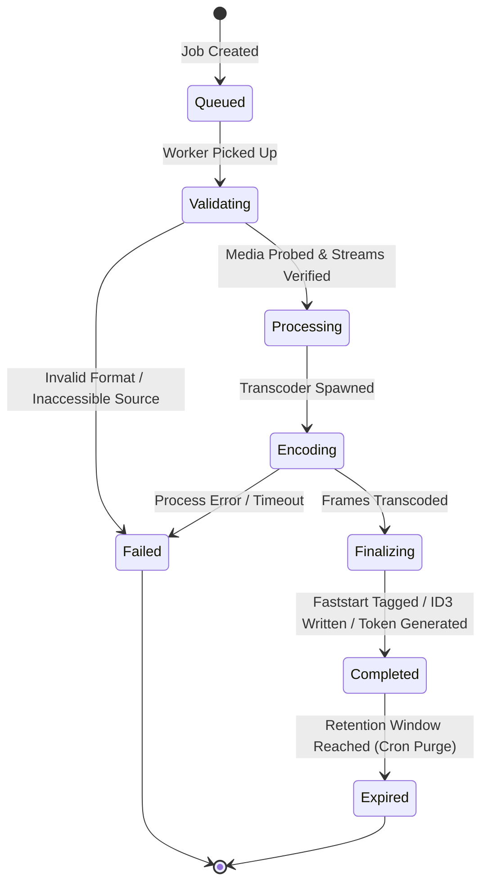

# PrismConvert (MediaConverter Pro) - System Architecture & Technical Specifications

This document outlines the full end-to-end technical architecture, security model, database schema, and conversion pipeline of **MediaConverter Pro**.

---

## 1. High-Level System Architecture

```mermaid
flowchart TD
    Client["Client (Browser / Mobile)"]
    WAF["Security & SSRF Filter"]
    REST["WordPress REST API Controller"]
    JM["Background Job Manager"]
    Conv["Conversion Orchestrator"]
    FFmpeg["FFmpeg / FFprobe Subprocess"]
    Storage["Secure Storage (Temp / Output)"]
    DM["Download Manager (Chunked / Range HTTP)"]
    DB[("WordPress DB (wp_media_conversion_jobs)")]

    Client -->|1. Submit URL or Upload File| REST
    REST -->|2. Verify Nonce, IP Rate Limit & SSRF| WAF
    WAF -->|3. Validated| JM
    JM -->|4. Insert Record (Status: queued)| DB
    JM -->|5. Dispatch Processing| Conv
    Conv -->|6. Probe & Transcode| FFmpeg
    FFmpeg -->|7. Real-Time -progress Stream| Conv
    Conv -->|8. Update Progress & Stages (0-100%)| DB
    FFmpeg -->|9. Write Muxed File| Storage
    Conv -->|10. Mark Completed & Issue HMAC Token| DB
    Client -->|11. Poll Progress (/jobs/uuid/progress)| REST
    REST -->|12. Fetch Status| DB
    Client -->|13. Stream Download (/download?token=...)| DM
    DM -->|14. Verify Token & Range Headers| Storage
```

---

## 2. Multi-Stage Conversion Lifecycle

Every media conversion transitions cleanly through deterministic states, preventing simulated or fake progress:



### Stage Definitions:
1. **Queued:** The job has been received and stored in the database.
2. **Validating:** The source file is inspected by FFprobe; video dimensions, audio streams, codecs, and durations are validated. Supported quality options are computed (no artificial upscaling).
3. **Processing:** Demuxing and filtergraph construction begins.
4. **Encoding:** Native H.264 video transcoding (CRF 22, medium preset, yuv420p) or LAME MP3 encoding (custom bitrate up to 320kbps). Real-time progress parsed from FFmpeg `-progress` output.
5. **Finalizing:** Application of `-movflags +faststart` for web streaming or ID3v2 tag writing.
6. **Completed:** File size confirmed, output path secured, cryptographic HMAC-SHA256 download token issued.
7. **Expired:** Automated hourly cron clears physical files from disk and marks database records as expired.

---

## 3. Database Schema

The plugin installs and maintains the custom table `wp_media_conversion_jobs` via standard WordPress `dbDelta`:

| Column Name | Data Type | Attributes | Description |
|---|---|---|---|
| `id` | `BIGINT(20) UNSIGNED` | `AUTO_INCREMENT PRIMARY KEY` | Internal database job identifier |
| `job_uuid` | `VARCHAR(64)` | `NOT NULL UNIQUE KEY` | Public UUID4 exposed to REST API |
| `user_id` | `BIGINT(20) UNSIGNED` | `DEFAULT 0, INDEX` | WordPress User ID (0 for Guests) |
| `source_type` | `VARCHAR(20)` | `NOT NULL DEFAULT 'upload'` | Source ingestion: `upload` or `url` |
| `source_url` | `TEXT` | `NULL` | Sanitized remote URL if source is remote |
| `original_filename` | `VARCHAR(255)` | `NOT NULL` | Sanitized original media filename |
| `input_path` | `TEXT` | `NULL` | Internal absolute server path to ingested media |
| `output_filename` | `VARCHAR(255)` | `NULL` | Sanitized output filename presented on download |
| `output_path` | `TEXT` | `NULL` | Internal absolute server path to converted file |
| `output_format` | `VARCHAR(10)` | `NOT NULL DEFAULT 'mp4'` | Target format: `mp4` or `mp3` |
| `output_quality` | `VARCHAR(50)` | `NOT NULL DEFAULT 'original'` | Quality preset: `original`, `1080p`, `720p`, `320k`, etc. |
| `status` | `VARCHAR(20)` | `NOT NULL DEFAULT 'queued', INDEX` | Current state: `queued`, `validating`, `processing`, `encoding`, `finalizing`, `completed`, `failed`, `expired`, `cancelled` |
| `stage` | `VARCHAR(50)` | `NOT NULL DEFAULT 'Queued'` | Human-readable UI status text |
| `progress` | `FLOAT` | `NOT NULL DEFAULT 0` | Genuine percentage (0.0 to 100.0) |
| `file_size` | `BIGINT(20) UNSIGNED` | `DEFAULT 0` | Finalized file size in bytes |
| `duration_seconds` | `FLOAT` | `DEFAULT 0` | Media runtime duration in seconds |
| `download_token` | `VARCHAR(64)` | `NULL, INDEX` | One-time or time-limited download token |
| `download_count` | `INT(11)` | `DEFAULT 0` | Number of times downloaded |
| `error_message` | `TEXT` | `NULL` | User-friendly error message if failed |
| `ip_hash` | `VARCHAR(64)` | `NULL` | GDPR-compliant SHA-256 salted hash of client IP |
| `batch_uuid` | `VARCHAR(64)` | `NULL, INDEX` | Optional UUID reference if job belongs to a playlist batch |
| `created_at` | `DATETIME` | `NOT NULL` | Job creation timestamp |
| `started_at` | `DATETIME` | `NULL` | Processing start timestamp |
| `completed_at` | `DATETIME` | `NULL` | Transcoding completion timestamp |
| `expires_at` | `DATETIME` | `NULL, INDEX` | Scheduled retention expiration date |

### Batch Playlist Table: `wp_media_conversion_batches`

| Column Name | Data Type | Attributes | Description |
|---|---|---|---|
| `id` | `BIGINT(20) UNSIGNED` | `AUTO_INCREMENT PRIMARY KEY` | Internal batch identifier |
| `batch_uuid` | `VARCHAR(64)` | `NOT NULL UNIQUE KEY` | Public Batch UUID4 |
| `user_id` | `BIGINT(20) UNSIGNED` | `DEFAULT 0, INDEX` | WordPress User ID |
| `playlist_url` | `TEXT` | `NOT NULL` | Original YouTube playlist URL |
| `playlist_title` | `VARCHAR(255)` | `NOT NULL DEFAULT 'Playlist Batch'` | Playlist title from metadata |
| `output_format` | `VARCHAR(10)` | `NOT NULL DEFAULT 'mp3'` | Output format for batch (`mp3` or `mp4`) |
| `output_quality` | `VARCHAR(50)` | `NOT NULL DEFAULT '320k'` | Output quality preset |
| `total_items` | `INT(11)` | `NOT NULL DEFAULT 0` | Total number of items in playlist |
| `completed_items` | `INT(11)` | `NOT NULL DEFAULT 0` | Converted items count |
| `failed_items` | `INT(11)` | `NOT NULL DEFAULT 0` | Failed items count |
| `status` | `VARCHAR(20)` | `NOT NULL DEFAULT 'queued', INDEX` | Batch status: `queued`, `processing`, `completed`, `failed` |
| `progress` | `FLOAT` | `NOT NULL DEFAULT 0` | Aggregate batch progress (0.0 to 100.0) |
| `zip_path` | `TEXT` | `NULL` | Path to compiled ZIP archive of all tracks |
| `zip_filename` | `VARCHAR(255)` | `NULL` | Filename of compiled ZIP archive |
| `zip_size` | `BIGINT(20) UNSIGNED` | `DEFAULT 0` | ZIP file size in bytes |
| `download_token` | `VARCHAR(64)` | `NULL, INDEX` | Cryptographic HMAC token for 1-click ZIP download |
| `created_at` | `DATETIME` | `NOT NULL` | Batch creation timestamp |
| `completed_at` | `DATETIME` | `NULL` | Batch completion timestamp |
| `expires_at` | `DATETIME` | `NULL, INDEX` | Batch retention expiration date |

---

## 4. Long Video & Playlist Processing Architecture

### 1. 2-Hour Video Single-Pass Stream Optimization
- **Problem Solved:** Long-form YouTube videos (e.g. 2+ hours) historically failed or took hours due to redundant double-pass re-encoding: yt-dlp first downloaded streams, and FFmpeg subsequently decoded and re-encoded 216,000+ frames on CPU (`libx264 veryfast`).
- **Single-Pass Finalized Execution:**
  - For **MP3 Audio**: yt-dlp streams the optimal audio track and extracts high-bitrate MP3 directly using `-x --audio-format mp3 --audio-quality [val] --embed-metadata` in a single pass.
  - For **MP4 Video**: yt-dlp merges pre-muxed streams directly using `--merge-output-format mp4 --postprocessor-args "ffmpeg:-c:v copy -c:a aac -b:a 192k"`, copying video packets losslessly without CPU transcoding overhead.
  - **Dynamic Timeout Scaling:** Transcoding subprocess timeouts dynamically scale to `2.5 × media duration` (up to 7,200s).
  - **Anti-Throttling:** YouTube DASH streaming utilizes `--concurrent-fragments 4` with 10 automated retries, avoiding 403 throttling or dropped TCP sockets on multi-gigabyte media.

### 2. Complete Playlist Conversion & 1-Click ZIP Packaging
- **Automatic Playlist Detection:** URLs containing `list=PL...` or `/playlist?list=...` are detected on paste or input.
- **Metadata Extraction:** `yt-dlp --flat-playlist -J` retrieves the entire tracklist, video durations, thumbnails, and author information within ~1.5 seconds.
- **Interactive Batch Configuration Card:** Users can toggle individual tracks or select all, configure batch target formats (MP3 / MP4), and launch asynchronous conversion in 1 click.
- **Detached Playlist Worker (`bin/playlist-worker.php`):** Sequentially converts each queued track, writes real-time progress to `wp_media_conversion_batches`, and automatically compiles all completed media files into an organized ZIP archive using native system tooling (`ZipArchive` or `tar -a -cf`).
- **Dual Delivery:** Users can download the entire compiled ZIP archive in 1 click or download individual converted tracks directly from the live progress card.

---

## 5. Security Architecture

### 1. SSRF (Server-Side Request Forgery) Defense
When remote media URLs are submitted:
- Enforces strict HTTPS protocol (HTTP rejected).
- Resolves domain hostname using public DNS (`gethostbynamel`).
- Rejects any destination resolving to:
  - Loopback (`127.0.0.0/8`, `::1`, `localhost`)
  - Private IPv4 ranges (`10.0.0.0/8`, `172.16.0.0/12`, `192.168.0.0/16`)
  - Link-local and cloud metadata addresses (`169.254.169.254`, `metadata.google.internal`)
  - Broadcast and reserved networks.

### 2. Path Traversal & File Containment
- All physical storage paths are verified with `wp_normalize_path` and `realpath`.
- Paths containing null bytes (`\0`) or parent directories (`..`) are rejected immediately.
- Files must reside strictly inside the designated `wp-content/uploads/media-converter/` root.

### 3. Protected Temporary Directories
- Storage directories contain an `index.php` silencer and an Apache `.htaccess` deny rule (`Require all denied`).
- Direct URL access to converted files returns `403 Forbidden`. Downloads are routed strictly through `Download_Manager` via authenticated tokens.

### 4. Cryptographic HMAC-SHA256 Download Tokens
- Download URLs do not expose database IDs or file system paths.
- Each token encapsulates `job_id:expires:signature` signed using WordPress `wp_salt('nonce')`. Tampered or expired tokens fail validation with zero server information disclosed.

### 5. Resumable Downloads (HTTP Range RFC 7233)
- `Download_Manager` supports HTTP `Range: bytes=start-end` requests, allowing browsers and download managers to resume interrupted downloads and seek within media players smoothly.
